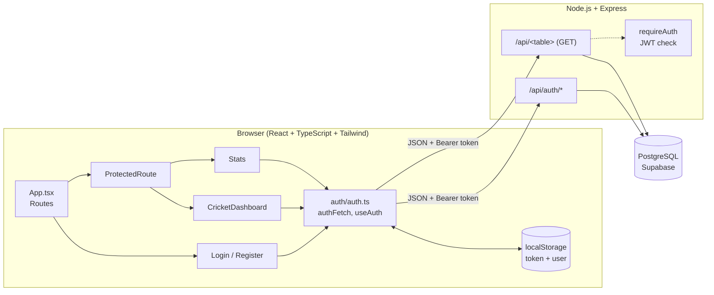
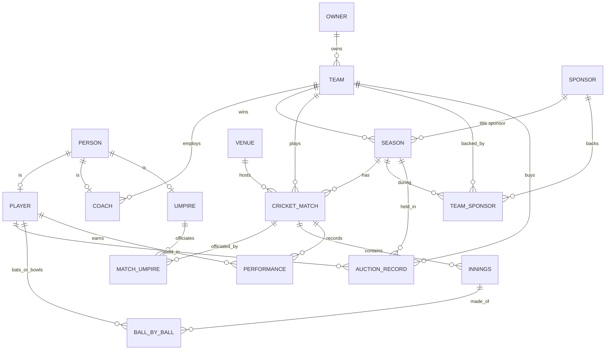
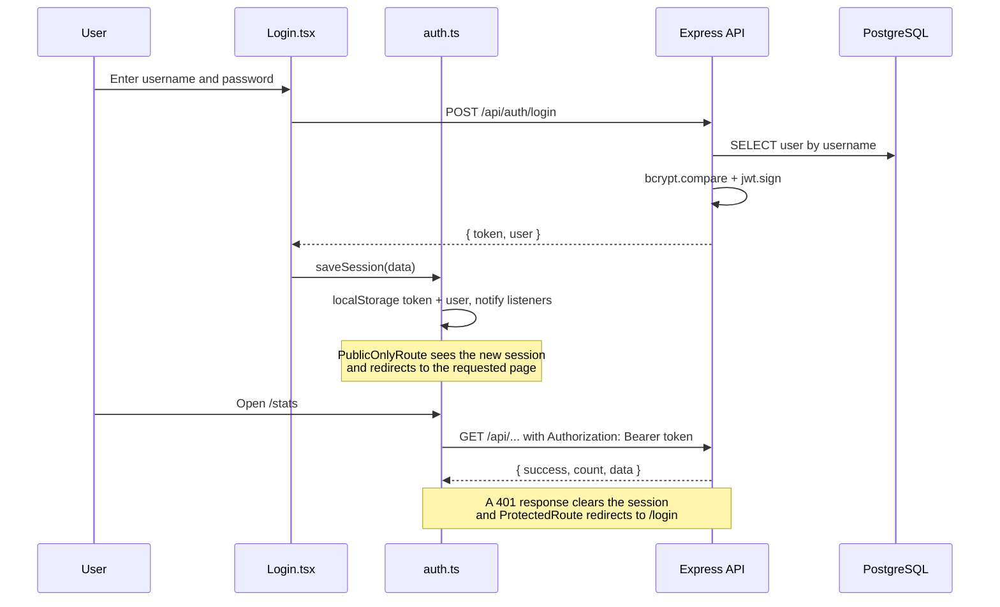

# 🏏 Scorebook — Cricket League Management System

A full-stack web application for managing and exploring a cricket league: teams, players, owners, sponsors, auctions, seasons, matches, innings and ball-by-ball scoring. It has secure sign-in with JWT, a data browser for every database table, and a statistics page with charts.

---

## Table of contents

1. [Features](#features)
2. [Tech stack](#tech-stack)
3. [Architecture](#architecture)
4. [Project structure](#project-structure)
5. [Database](#database)
6. [Backend](#backend)
7. [API reference](#api-reference)
8. [Frontend](#frontend)
9. [Components reference](#components-reference)
10. [Authentication flow](#authentication-flow)
11. [Getting started](#getting-started)
12. [Environment variables](#environment-variables)
13. [Design system](#design-system)
14. [Security notes](#security-notes)
15. [Troubleshooting](#troubleshooting)
16. [Known limitations & roadmap](#known-limitations--roadmap)

---

## Features

- **Authentication:** register, sign in, "keep me signed in", sign out, JWT sessions, rate-limited auth endpoints.
- **Route protection:** signed-out visitors are redirected to the login page and returned to the page they wanted after signing in. Role-based pages are supported.
- **Data tables:** browse all 16 database tables with search, column sorting, pagination and foreign keys shown as readable names (for example, a team name instead of `team_id`).
- **Stats dashboard:** headline numbers, points table, toss and batting-first insights, runs by season, top run scorers and wicket takers, dismissal types, scoring rate by over, ball outcomes, auction analysis and venue usage.
- **Cricket-themed UI:** outfield green, cricket-white and ball-crimson palette, responsive layout, accessible forms and keyboard focus styles.

---

## Tech stack

| Layer | Technology | Purpose |
|---|---|---|
| Frontend framework | **React 18+** with **TypeScript** | UI and type safety |
| Build tool | **Vite** | Dev server and production build (`import.meta.env` is used for config) |
| Styling | **Tailwind CSS** | Login, Register, Stats and route screens |
| Styling (dashboard) | Scoped CSS string inside the component | Data-table dashboard theme |
| Routing | **react-router-dom** | Pages and route guards |
| Charts | **Recharts** (plus a small custom SVG ring) | Stats page |
| Fonts | Google Fonts: **Barlow Condensed**, **IBM Plex Sans** | Scoreboard-style headings and readable body text |
| Backend runtime | **Node.js** | Server |
| Backend framework | **Express** | REST API |
| Database | **PostgreSQL** (hosted on **Supabase**) | Data storage |
| DB driver | **pg** (connection pool in `db.js`) | SQL queries |
| Password hashing | **bcryptjs** | Secure password storage |
| Sessions | **jsonwebtoken (JWT)** | Stateless authentication |
| Rate limiting | **express-rate-limit** | Brute-force protection on auth routes |
| Misc | **cors**, **dotenv** | Cross-origin requests, environment config |

---

## Architecture



---

## Project structure

A suggested layout is one repository with two folders:

```
cricket-league/
├── backend/
│   ├── server.js            # Express app: auth + table routes
│   ├── db.js                # PostgreSQL connection pool (exports `pool`)
│   ├── users_postgres.sql   # users table + row level security
│   ├── package.json
│   └── .env                 # PORT, JWT_SECRET, database settings (never commit)
│
├── frontend/
│   ├── index.html
│   ├── package.json
│   ├── .env                 # VITE_API_URL
│   └── src/
│       ├── main.tsx         # React entry point
│       ├── App.tsx          # Route table
│       ├── Login.tsx        # Sign-in page
│       ├── Register.tsx     # Account creation page
│       ├── CricketDashboard.tsx   # Data browser for all tables
│       ├── Stats.tsx        # Charts and statistics
│       └── auth/
│           ├── auth.ts            # Session storage, authFetch, useAuth hook
│           └── ProtectedRoute.tsx # ProtectedRoute, PublicOnlyRoute, Forbidden
│
└── README.md
```

---

## Database

The schema has **16 league tables** plus a **`users`** table for sign-in. On PostgreSQL, table names are lower-case (for example `cricket_match`), and the API reads them from the `public` schema.

### League tables

| Table | Primary key | Foreign keys | Notes |
|---|---|---|---|
| `person` | `person_id` | — | `name`, `dob` |
| `owner` | `owner_id` | — | `company_name` (unique) |
| `sponsor` | `sponsor_id` | — | `brand_name` (unique) |
| `venue` | `venue_id` | — | `name` (unique), `capacity` > 0 |
| `team` | `team_id` | `owner_id` → owner | `name` (unique), `city` |
| `player` | `person_id` | `person_id` → person | `role`, `batting_style`, `bowling_style` |
| `coach` | `person_id` | `person_id` → person, `team_id` → team | `role` |
| `umpire` | `person_id` | `person_id` → person | `experience_years` ≥ 0, `specialization` |
| `season` | `season_id` | `sponsor_id` → sponsor, `winner_team_id` → team | `year` (unique) |
| `cricket_match` | `match_id` | `season_id`, `venue_id`, `team1_id`, `team2_id`, `toss_winner_id`, `winner_team_id` | `team1_id` ≠ `team2_id` |
| `match_umpire` | `match_umpire_id` | `match_id` → cricket_match, `person_id` → umpire | unique (`match_id`, `person_id`) |
| `team_sponsor` | `team_sponsor_id` | `team_id`, `sponsor_id`, `season_id` | unique (`team_id`, `sponsor_id`, `season_id`) |
| `auction_record` | `auction_id` | `player_id` → player, `team_id`, `season_id` | `sold_price` ≥ 0 |
| `innings` | `innings_id` | `match_id`, `batting_team_id` | `innings_number` > 0, `total_wickets` 0–10, unique (`match_id`, `innings_number`) |
| `ball_by_ball` | `ball_id` | `innings_id`, `batter_id` → player, `bowler_id` → player | `over_number`, `ball_number`, `runs_scored`, `dismissals_type`, `extra_type`; unique per ball in an innings |
| `performance` | `performance_id` | `match_id`, `player_id` → player | `runs`, `wickets`; unique (`match_id`, `player_id`) |

### Relationships



### `users` table (authentication)

Run `backend/users_postgres.sql` in the Supabase SQL editor:

```sql
create table public.users (
    user_id serial primary key,
    username varchar(30) not null unique,
    password_hash varchar(100) not null,
    role varchar(20) not null default 'viewer' check (role in ('viewer', 'admin')),
    created_at timestamptz not null default now()
);

alter table public.users enable row level security;
```

Row level security is turned on so the password hashes cannot be read through Supabase's public REST API. The Express server connects directly to the database, so it is not affected.

To make someone an admin:

```sql
update public.users set role = 'admin' where username = 'your_username';
```

---

## Backend

**Location:** `backend/server.js`, using Express and the `pg` pool from `db.js`.

### What it does

- Serves a JSON REST API under `/api`.
- Provides **register**, **login** and **me** endpoints with bcrypt (cost 12) and JWT.
- Registers a **read-only `GET` endpoint for every league table** from one `tables` config object (the table names come from this fixed list, never from user input).
- Rate-limits register and login to 20 requests per 15 minutes per IP.
- Handles unknown routes (404) and unexpected errors (500) with JSON responses.
- Shuts down gracefully on `SIGINT` and `SIGTERM`, closing the database pool.

### Middleware

| Middleware | Role |
|---|---|
| `cors()` | Allows the frontend origin to call the API |
| `express.json()` | Parses JSON request bodies |
| `authLimiter` | Rate limit for `/api/auth/register` and `/api/auth/login` |
| `requireAuth` | Verifies `Authorization: Bearer <token>` and sets `req.user`. Add it to any route that should be private |

---

## API reference

Base URL: `http://localhost:5000` (the frontend uses `http://localhost:5000/api` through `VITE_API_URL`).

### Health

| Method | Path | Description |
|---|---|---|
| GET | `/` | Returns `{ "message": "Backend server is running!" }` |
| GET | `/api/db-test` | Checks the Supabase connection, returns database name and server time |

### Authentication

#### `POST /api/auth/register`

Creates a `viewer` account.

```json
// Request
{ "username": "captain07", "password": "at-least-8-chars" }

// 201 Created
{ "message": "Account created. You can sign in now." }
```

| Status | Meaning |
|---|---|
| 400 | Username not 3–30 characters of letters, numbers, `.`, `-`, `_`, or password shorter than 8 characters |
| 409 | Username already taken |
| 429 | Too many attempts |

#### `POST /api/auth/login`

```json
// Request
{ "username": "captain07", "password": "at-least-8-chars", "remember": true }

// 200 OK
{
  "token": "<JWT>",
  "user": { "id": 1, "username": "captain07", "role": "viewer" }
}
```

- The token lasts **30 days** when `remember` is true, otherwise **8 hours**.
- The token payload contains `sub` (user id), `username` and `role`.

| Status | Meaning |
|---|---|
| 400 | Missing username or password |
| 401 | Wrong username or password |
| 429 | Too many attempts |

#### `GET /api/auth/me`

Header: `Authorization: Bearer <token>`. Returns `{ "user": { "id", "username", "role" } }`, or `401` if the token is missing, invalid or expired.

### League data (all `GET`)

Each endpoint returns every row of its table, ordered by primary key ascending:

```json
{ "success": true, "count": 8, "data": [ { "team_id": 1, "name": "…" } ] }
```

On failure: `500` with `{ "success": false, "message": "Failed to fetch <endpoint>" }`.

| Endpoint | Table | Primary key |
|---|---|---|
| `/api/persons` | `person` | `person_id` |
| `/api/owners` | `owner` | `owner_id` |
| `/api/sponsors` | `sponsor` | `sponsor_id` |
| `/api/venues` | `venue` | `venue_id` |
| `/api/teams` | `team` | `team_id` |
| `/api/players` | `player` | `person_id` |
| `/api/coaches` | `coach` | `person_id` |
| `/api/umpires` | `umpire` | `person_id` |
| `/api/seasons` | `season` | `season_id` |
| `/api/matches` | `cricket_match` | `match_id` |
| `/api/match-umpires` | `match_umpire` | `match_umpire_id` |
| `/api/team-sponsors` | `team_sponsor` | `team_sponsor_id` |
| `/api/auction-records` | `auction_record` | `auction_id` |
| `/api/innings` | `innings` | `innings_id` |
| `/api/ball-by-ball` | `ball_by_ball` | `ball_id` |
| `/api/performances` | `performance` | `performance_id` |

> **Access control:** these routes are public by default. To require sign-in, add `requireAuth` in the registration loop:
> `app.get(`/api/${endpoint}`, requireAuth, async (req, res) => { … })`
> The frontend already sends the token with every request.

### Error format

Auth endpoints and the 404/500 handlers return `{ "message": "…" }` with a matching HTTP status.

---

## Frontend

### Routes

| Path | Guard | Page |
|---|---|---|
| `/login` | `PublicOnlyRoute` | `Login` |
| `/register` | `PublicOnlyRoute` | `Register` |
| `/` | `ProtectedRoute` | `CricketDashboard` (data tables) |
| `/stats` | `ProtectedRoute` | `Stats` (charts) |
| `*` | — | Redirects to `/` |

A role-limited page can be added with `<ProtectedRoute roles={["admin"]} />` (an example is commented in `App.tsx`).

### How data loads

Every page uses `authFetch(path)`, which prepends `VITE_API_URL`, adds the `Authorization` header and signs the person out on a `401`. Responses are normalised by a small `toRows` helper that accepts a plain array or an object such as `{ data: [...] }`, so the backend's `{ success, count, data }` format works.

---

## Components reference

### `App.tsx`

Sets up `BrowserRouter` and the route table. Contains two small wrappers, `LoginPage` and `RegisterPage`, that connect the pages to `useNavigate`.

### `Login.tsx`

Sign-in page with a split cricket layout (pitch stripes and stat tiles on the left, form on the right).

| Prop | Type | Description |
|---|---|---|
| `onGoToRegister` | `() => void` | Called by the "Request access" button |

Features: username and password fields, show/hide password, "Keep me signed in", loading spinner, server and network error messages, labelled and accessible inputs. On success it calls `saveSession(body)`, which stores the token; `PublicOnlyRoute` then redirects automatically.

### `Register.tsx`

Account creation page.

| Prop | Type | Description |
|---|---|---|
| `onRegistered` | `() => void` | Called from the success screen ("Go to sign in") |
| `onGoToLogin` | `() => void` | Called by the footer "Sign in" button |

Features:
- Live validation after a field is touched or the form is submitted, with focus moved to the first invalid field.
- Username rule `^[a-zA-Z0-9_.-]{3,30}$` and password minimum of 8 characters, matching the backend.
- Password strength meter (Weak / Fair / Good / Strong) and checklist (length, upper and lower case, number, symbol).
- Confirm password with a match indicator, and an agreement checkbox.
- A taken username (409) is shown under the username field; other errors show in a banner.
- Success screen after registering.

### `auth/auth.ts` (no React Context)

All authentication logic lives in plain functions plus one hook.

| Export | Type | Description |
|---|---|---|
| `saveSession(data)` | function | Stores the token under `token` and the user under `user` in `localStorage`, then notifies listeners |
| `logout()` | function | Removes both keys and notifies listeners |
| `getToken()` | function | Returns the saved JWT, or `null` if missing or expired |
| `getUser()` | function | Returns the saved user, or `null` |
| `isLoggedIn()` | function | `true` when a valid token and user exist |
| `authFetch(path, init?)` | function | `fetch` against the API with the Bearer token; signs out on `401` |
| `useAuth()` | hook | Returns `{ token, user, isLoggedIn, isAdmin }`, re-renders on sign-in or sign-out (including in other tabs) and signs out automatically when the token expires |
| `TOKEN_KEY`, `USER_KEY` | constants | `"token"` and `"user"` |

`useAuth` is built on React's `useSyncExternalStore`, so **React 18 or newer is required**.

### `auth/ProtectedRoute.tsx`

| Export | Description |
|---|---|
| `ProtectedRoute` | Props: `roles?: string[]`, `redirectTo?: string` (default `/login`), `children?`. Redirects signed-out visitors to the login page and remembers the requested page. Shows `Forbidden` if the user's role is not allowed. Works as a layout route (`<Outlet />`) or as a wrapper |
| `PublicOnlyRoute` | Redirects signed-in users away from `/login` and `/register`, back to the page they originally wanted (or `/`) |
| `Forbidden` | Cricket-themed "You're out!" page for role mismatches |

### `CricketDashboard.tsx`

Data browser for every table.

- **Config-driven:** the `TABLES` object defines, for each table, its sidebar group, primary key, API endpoint and columns. Adding a table means adding one entry.
- **Sidebar:** tables grouped as *People*, *Franchise*, *Tournament* and *Match centre*, each with a live row count, a link to the Stats page, and the signed-in user with a **Sign out** button.
- **Table view:** scoreboard-style header with record count, search across visible text, sortable columns (click to cycle ascending, descending, none), pagination (15 rows per page) and a sticky header.
- **Foreign keys as names:** ids are resolved through in-memory lookups (for example `winner_team_id` shows the team name). Hover shows the raw id.
- **Formatting:** dates, ₹ amounts in Indian number format, role and dismissal badges.
- **Resilience:** if a table fails to load, the rest still render and a banner names the failure.

Internal pieces: `useCricketData()` (loads all tables in parallel) and the `CSS` string with the theme.

### `Stats.tsx`

Statistics page. It loads 12 tables and computes everything in the browser inside `computeStats`.

| Section | Chart / element | Source tables |
|---|---|---|
| Headline numbers | 8 KPI cards (teams, players, matches, runs, wickets, fours, sixes, auction spend) | team, player, cricket_match, innings, ball_by_ball, auction_record |
| Points table | Table with win % bars (2 points for a win, 1 for no result) | cricket_match, team |
| Match insights | Two rings: toss winner wins %, bat-first wins % | cricket_match, innings |
| Runs by season | Area (total runs) + line (average per innings) | innings, cricket_match, season |
| Squad roles | Donut | player |
| Top run scorers / wicket takers | Horizontal bars | performance, person |
| How batters get out | Donut | ball_by_ball |
| Scoring rate by over | Line | ball_by_ball |
| Ball outcomes | Column chart (dots, 1s … 6s; boundaries highlighted) | ball_by_ball |
| Most expensive buys / spend by team | Horizontal bars (₹ Cr / L) | auction_record, person, team |
| Matches by venue | Horizontal bars | cricket_match, venue |

Helper components: `Panel`, `Kpi`, `HBars`, `Donut`, `Ring` and a custom `Tip` tooltip. The `SOURCES` map at the top lists the API paths and is the one place to edit if routes change.

---

## Authentication flow



---

## Getting started

### Prerequisites

- Node.js 18 or newer
- A PostgreSQL database (a free Supabase project works)
- npm

### 1. Database

1. Create your project in Supabase.
2. Create the 16 league tables (your schema script), then run `backend/users_postgres.sql`.
3. Load some sample data so the dashboard and stats have something to show.

### 2. Backend

```bash
cd backend
npm install express cors dotenv pg bcryptjs jsonwebtoken express-rate-limit
npm install -D nodemon
```

Create `backend/.env` (see [Environment variables](#environment-variables)), then:

```bash
npx nodemon server.js     # development
node server.js            # production
```

Check it works: open `http://localhost:5000/api/db-test`.

### 3. Frontend

```bash
cd frontend
npm install react react-dom react-router-dom recharts
npm install -D typescript vite @vitejs/plugin-react tailwindcss
```

Set up Tailwind by following the official guide for your version, then create `frontend/.env`:

```
VITE_API_URL=http://localhost:5000/api
```

```bash
npm run dev      # http://localhost:5173
npm run build    # production build in dist/
```

### 4. First use

1. Open the app and choose **Request access** to register.
2. Sign in; you land on the data dashboard.
3. (Optional) Promote yourself to admin with the SQL shown in [Database](#users-table-authentication).

---

## Environment variables

### Backend (`backend/.env`)

| Variable | Required | Description |
|---|---|---|
| `PORT` | No | Server port (default `5000`) |
| `JWT_SECRET` | **Yes** | Long random string used to sign tokens. The server will not start without it |
| Database settings | **Yes** | Whatever your `db.js` reads (typically a `DATABASE_URL` Supabase connection string) |

### Frontend (`frontend/.env`)

| Variable | Required | Description |
|---|---|---|
| `VITE_API_URL` | No | API base URL (default `http://localhost:5000/api`) |

Never commit `.env` files. Add them to `.gitignore`.

---

## Design system

| Token | Hex | Use |
|---|---|---|
| Outfield green | `#14352a` | Primary, headers, sidebars |
| Green (hover) | `#1d4a3a` | Hover states |
| Green (soft) | `#2b6150` | Borders, secondary chart colour |
| Cricket white | `#f4f6f2` | Page background |
| Ball crimson | `#a4161a` | Accent, primary-button underline, key chart series |
| Straw | `#d9c38a` | Focus rings, highlights |
| Ink | `#12201a` | Body text |
| Muted | `#5d6e64` | Secondary text |
| Line | `#d5dcd3` | Borders |

- **Typography:** *Barlow Condensed* for headings and scoreboard numbers, *IBM Plex Sans* for body text.
- **Motifs:** a stitched cricket-ball icon, pitch-stripe backgrounds and a crimson underline on primary buttons.
- **Accessibility:** labelled form controls, `aria-invalid` and live error messages, visible focus outlines, `aria-sort` on table headers, reduced-motion friendly transitions.

---

## Security notes

- Passwords are hashed with **bcrypt (cost 12)**. A dummy hash is compared when the username does not exist, so response time does not reveal valid usernames.
- Login and register are **rate-limited** (20 requests per 15 minutes per IP). If you deploy behind a proxy, set `app.set("trust proxy", 1)`.
- All SQL uses **parameterised queries**. Table and column names come only from the fixed `tables` object.
- JWTs expire after 8 hours or 30 days. The client also checks expiry, but **the server is the real authority**.
- The token is stored in `localStorage`, which is simple but readable by any script on the page if the site has a cross-site scripting bug. For a more hardened setup, use an httpOnly cookie.
- **Enable row level security** on `users` (included in the SQL) so hashes cannot be read through Supabase's public API.
- Hiding pages in the browser is not security. Protect sensitive routes with `requireAuth` and check `req.user.role` on the server for admin actions.
- Set a strong `JWT_SECRET`, and restrict `cors()` to your frontend origin in production.

---

## Troubleshooting

| Symptom | Likely cause and fix |
|---|---|
| `(data[k] ?? []).map is not a function` | An endpoint returned an object, not an array. The current code unwraps `{ data: [...] }`. If it still happens, open the endpoint in the browser and check the response |
| A table shows "Couldn't load … (HTTP 404)" | The endpoint name doesn't match the backend. Edit `endpoint` in `TABLES` (dashboard) or `SOURCES` (stats) |
| Everything redirects to `/login` | No valid token. Sign in again; check that `token` exists in DevTools → Application → Local Storage |
| `401` on data routes | Token expired or `JWT_SECRET` changed. Sign in again |
| "Can't reach the server" on login | The API isn't running, or `VITE_API_URL` is wrong |
| CORS errors in the console | Make sure `cors()` is enabled and the API URL is correct |
| Server exits with "JWT_SECRET is missing" | Add `JWT_SECRET` to `backend/.env` |
| Charts say "No data yet" | The table is empty. Add rows, or check for a failed-table banner |
| Stats page is slow | `ball_by_ball` is large. Move the calculations to a backend `/api/stats` endpoint using SQL `GROUP BY` |
| `useSyncExternalStore` is not exported | Upgrade to React 18 or newer |

---

## Known limitations & roadmap

- Data routes are read-only; there are no create, update or delete endpoints yet.
- Registration is open and creates `viewer` accounts. Promoting an admin is done in SQL.
- There is no refresh-token flow, password reset or email verification.
- Statistics are calculated in the browser and should move server-side for large datasets.
- Ideas for next steps:
  - Admin forms to add and edit teams, players, matches and scores.
  - Live match scoring screen using `ball_by_ball`.
  - Player and team profile pages.
  - Server-side pagination and an `/api/stats` endpoint.
  - Automated tests (Vitest and React Testing Library on the frontend, Supertest on the backend).
  - Docker setup and CI.

---

## License

Add your license here (for example MIT).